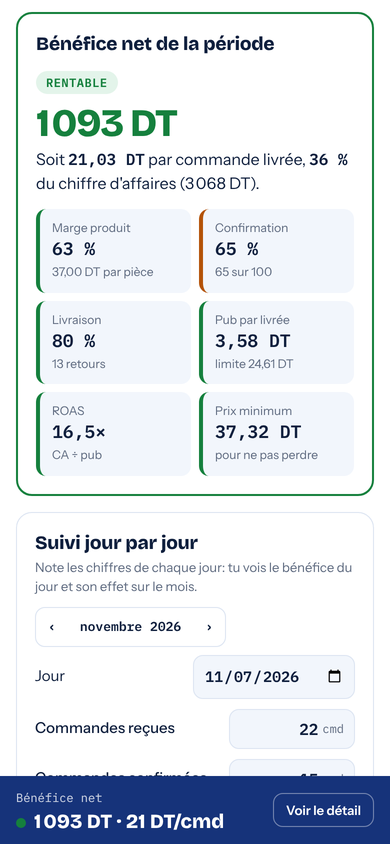
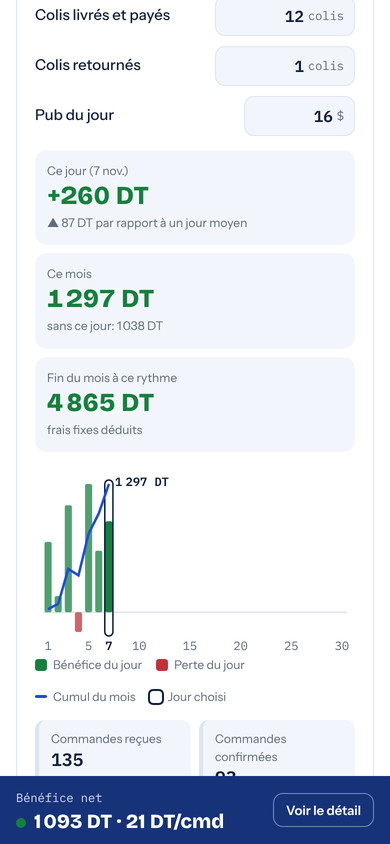

<div align="center">


# E-Calculator

**Combien tu gagnes vraiment par commande?**<br>
Le calculateur gratuit pour les vendeurs en ligne en Tunisie qui travaillent en paiement à la livraison.

[](https://chaouch-haroun.github.io/E-Calculator/)


<br>

&nbsp;&nbsp;
&nbsp;&nbsp;


</div>

---

## ✨ Ce que tu obtiens

| | |
|---|---|
| 💰 **Ton vrai bénéfice** | Après produit, emballage, livraison, retours, retenue 3 % et pub. Par période et par commande livrée. |
| 🚦 **Vert, orange, rouge** | Chaque chiffre est jugé: marge, confirmation, livraison, coût de la pub, ROAS. Tu vois tout de suite ce qui te coûte. |
| 🎯 **Tes limites** | Pub maximum par commande et prix minimum pour ne pas perdre d'argent. |
| 📅 **Suivi jour par jour** | Note chaque jour: tu vois le bénéfice du jour, le total du mois et la fin du mois à ce rythme. |
| 📊 **Graphiques** | Où part ton argent, tes commandes étape par étape, et « et si ça change? » (livraison, confirmation, pub, prix). |
| 📄 **Rapport** | Un fichier CSV pour Excel, ou un copier-coller direct dans Google Sheets. |
| 📦 **Plusieurs produits** | Un calcul et un suivi séparés pour chaque produit, plus le total de tous tes produits. |
| 🌍 **3 langues** | Français, anglais et arabe (de droite à gauche). |

---

## 📲 Installer l'app (1 minute)

L'app s'installe depuis le navigateur. Il n'y a rien à télécharger depuis un store et aucun fichier .exe.

### Android (Chrome)
1. Ouvre **https://chaouch-haroun.github.io/E-Calculator/** dans Chrome.
2. Touche **Installer l'app** en haut de la page.<br>
   Pas de bouton? Menu **⋮** → **Installer l'application** (ou **Ajouter à l'écran d'accueil**).
3. L'icône **E-Calculator** apparaît sur ton écran d'accueil.

### iPhone (Safari)
1. Ouvre le lien dans **Safari**.
2. Touche le bouton **Partager** (le carré avec la flèche).
3. Choisis **Sur l'écran d'accueil**, puis **Ajouter**.

### Ordinateur (Chrome ou Edge)
1. Ouvre le lien.
2. Clique sur **Installer l'app** en haut de la page, ou sur l'icône d'installation à droite de la barre d'adresse.
3. E-Calculator s'ouvre dans sa propre fenêtre et apparaît dans le menu Démarrer ou dans le Dock.

> Après l'installation, E-Calculator marche **sans internet**. Quand tu es connecté, l'app se met à jour toute seule et tes chiffres restent.

---

## 🧭 Comment l'utiliser

**0. Présente-toi** (une seule fois): ton nom, le nom de ta boutique et ton numéro. Ensuite le calculateur s'ouvre directement.

**1. Remplis tes chiffres**: prix de vente, coût du produit, emballage, frais de livraison et de retour, pub (en $ ou en DT), retenue 3 % si tu n'as pas de matricule fiscal.

**2. Mets tes commandes**: combien tu en as **reçu**, combien sont **confirmées**, combien de colis sont **livrés et payés**. La page calcule les taux pour toi.

**3. Lis le résultat**: le bénéfice net en haut, les cases vertes, orange ou rouges, puis les conseils en bas.

**4. Chaque jour, remplis « Suivi jour par jour »**: choisis le jour, puis note les commandes, les colis livrés et retournés, et la pub du jour. Tu vois:
- le **bénéfice du jour** et la comparaison avec un jour moyen;
- le **total du mois**, et ce qu'il serait **sans ce jour**;
- la **fin du mois à ce rythme**;
- un graphique des jours du mois (touche une barre pour corriger ce jour).

**5. Exporte**: **Télécharger le rapport (CSV)** pour Excel, ou **Copier pour Google Sheets** puis colle dans une feuille.

> 💡 Pas encore de chiffres? Touche **Voir un exemple** pour voir la page remplie. **Remettre à zéro** efface le calcul mais garde ton suivi jour par jour.

---

## 🧮 Comment le calcul marche

Le calcul suit le paiement à la livraison:

```
Commandes reçues ─► confirmées ─► livrées et payées
                                 └► retournées (reviennent en stock)
```

| Élément | Compté sur |
|---|---|
| Chiffre d'affaires | colis livrés × prix de vente |
| Coût du produit | colis livrés (les retours reviennent en stock) |
| Emballage | colis envoyés (confirmés) |
| Livraison | colis livrés, sauf si le client la paie en plus |
| Frais de retour | colis retournés |
| Retenue 3 % | montant encaissé, si tu n'as pas de matricule fiscal |
| Pub | ce que tu as dépensé ($ × ton taux réel, ou DT) |
| Frais fixes | une fois par période ou par mois |

**Bénéfice net = chiffre d'affaires − tous ces coûts.**

Repères utilisés pour les couleurs (indicatifs, à adapter à ton produit):

| | 🟢 Bien | 🟠 Juste | 🔴 Attention |
|---|---|---|---|
| Marge produit | ≥ 55 % | 40–55 % | < 40 % |
| Confirmation | ≥ 70 % | 50–70 % | < 50 % |
| Livraison | ≥ 80 % | 65–80 % | < 65 % |
| ROAS | ≥ 4× | 2,5–4× | < 2,5× |

---

## 🔒 Tes données

- Tes chiffres de vente restent **sur ton téléphone ou ton ordinateur**, dans le navigateur. Ils ne sont envoyés nulle part.
- À la première ouverture, on te demande ton nom, le nom de ta boutique et ton numéro, avec ton accord. Seuls ces 3 champs sont envoyés à l'équipe E-Calculator, pour pouvoir te contacter.
- Tout est enregistré **à chaque modification**: ferme l'app et rouvre-la, tu retrouves tout.
- Ils disparaissent seulement si tu effaces les données du site dans ton navigateur, ou si tu désinstalles l'app.
- Chaque appareil garde sa propre copie. Pour passer d'un appareil à l'autre: menu **⋯** → **Exporter**, puis **Importer** sur l'autre.

---

## ❓ Questions fréquentes

<details>
<summary><b>C'est vraiment gratuit?</b></summary>
Oui. Pas de compte, pas d'abonnement, pas de publicité.
</details>

<details>
<summary><b>Je ne vois pas le bouton « Installer l'app ».</b></summary>
Sur iPhone, utilise Safari → Partager → Sur l'écran d'accueil. Sur Android et sur ordinateur, utilise Chrome ou Edge: le bouton apparaît après quelques secondes, ou passe par le menu du navigateur. Si l'app est déjà installée, le bouton ne s'affiche plus.
</details>

<details>
<summary><b>Pourquoi le bénéfice du suivi n'est pas le même que celui du calcul?</b></summary>
Le suivi compte les colis retournés que tu notes. Le calcul considère que tous les colis confirmés et non livrés sont des retours. Touche <b>Mettre ce mois dans le calcul</b> pour utiliser les chiffres du mois dans le calcul.
</details>

<details>
<summary><b>Le fichier CSV s'ouvre mal dans Excel.</b></summary>
En français et en arabe, le fichier utilise le point-virgule et la virgule décimale (comme Excel en français). En anglais, il utilise la virgule et le point. Choisis la langue qui correspond à ton Excel avant de télécharger.
</details>

<details>
<summary><b>Comment mettre le rapport dans Google Sheets?</b></summary>
Touche <b>Copier pour Google Sheets</b>, ouvre une feuille vide et colle (Ctrl+V). Ou télécharge le CSV puis Fichier → Importer.
</details>

---

<details>
<summary><b>🇬🇧 English</b></summary>

**E-Calculator** is a free profit calculator for cash-on-delivery e-commerce sellers in Tunisia: real profit after product, packaging, delivery, returns, 3 % withholding and ads; colour-coded checks; max ad spend and minimum price; day-by-day tracking with the effect on your month; CSV / Google Sheets report; several products; French, English and Arabic.

**Install:** open **https://chaouch-haroun.github.io/E-Calculator/**.
- **Android / computer (Chrome, Edge):** tap **Install the app** (or browser menu → Install app).
- **iPhone (Safari):** Share → Add to Home Screen.

It then works offline and updates itself when online. Your sales numbers are saved on your device at every change and never sent anywhere. On first launch you're asked, with your consent, for your name, shop name and phone number; only these 3 fields are sent to the E-Calculator team. Use ⋯ → Export / Import to move them to another device.
</details>

<details>
<summary><b>🇹🇳 بالعربية</b></summary>

<div dir="rtl">

**E-Calculator** حاسبة مجانية للبائعين عبر الإنترنت في تونس بالدفع عند الاستلام: الربح الحقيقي بعد المنتج والتغليف والتوصيل والمرتجعات وخصم 3% والإشهار، ومتابعة يومية وتأثيرها على الشهر، وتقرير CSV أو Google Sheets.

**التثبيت:** افتح **https://chaouch-haroun.github.io/E-Calculator/**
- **أندرويد أو حاسوب (Chrome أو Edge):** اضغط «ثبّت التطبيق»، أو من قائمة المتصفح ← تثبيت التطبيق.
- **آيفون (Safari):** زر المشاركة ← «إضافة إلى الشاشة الرئيسية».

بعد التثبيت يعمل بدون إنترنت. أرقام مبيعاتك تُحفظ على جهازك عند كل تغيير ولا تُرسل إلى أي مكان. عند أول فتح يُطلب منك، بموافقتك، اسمك واسم متجرك ورقمك؛ وهذه الخانات الثلاث فقط تُرسل إلى فريق E-Calculator.

</div>
</details>

---

<details>
<summary><b>🛠️ Pour les développeurs</b></summary>

Un site statique: un seul `index.html` (HTML, CSS et JavaScript, sans framework ni build), plus une app web installable.

| Fichier | Rôle |
|---|---|
| `index.html` | toute l'app: calcul, graphiques SVG, suivi, rapport, 3 langues |
| `manifest.webmanifest` | nom, icônes et couleurs pour l'installation |
| `sw.js` | garde une copie de la page pour le mode hors ligne (réseau d'abord, cache si hors ligne) |
| `icon-*.png` | icônes de l'app |

Données: `localStorage` du navigateur (`ecalc-projects`, un objet par produit avec les champs du calcul et `J` pour le suivi jour par jour). `navigator.storage.persist()` est demandé au premier enregistrement.

Mise à jour: remplace `index.html` (et `sw.js` si besoin), puis commit. GitHub Pages publie en 1 à 2 minutes et les apps installées prennent la nouvelle version à la prochaine ouverture avec internet.
</details>

<div align="center">
<sub>Fait pour les vendeurs en Tunisie 🇹🇳 · licence MIT · les chiffres sont indicatifs: vérifie tes frais réels avec ta société de livraison.</sub>
</div>
